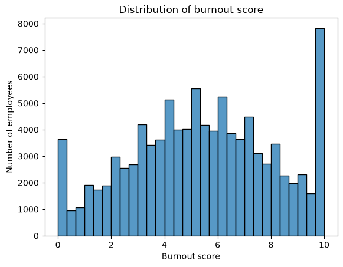
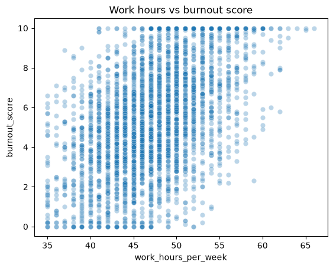
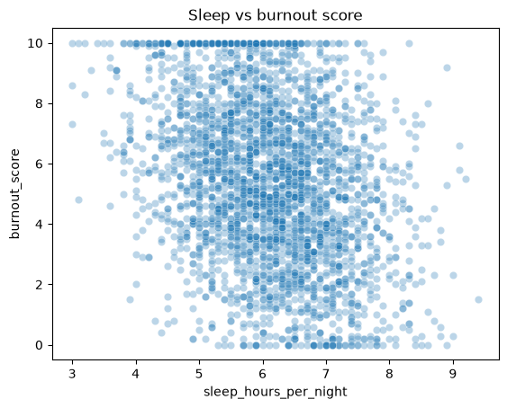
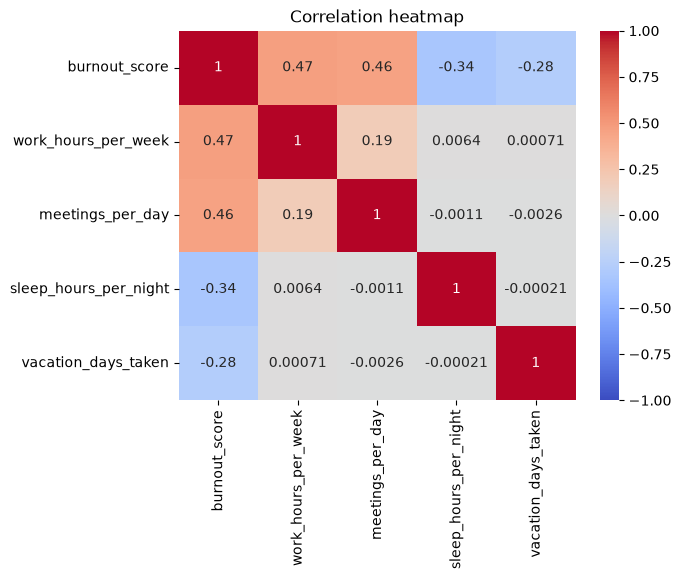
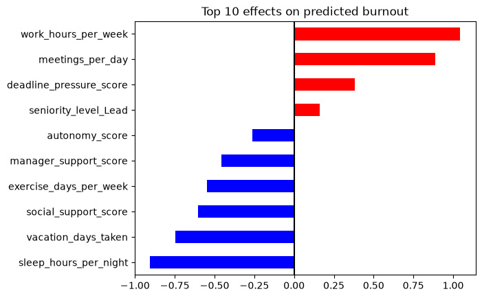

# Predicting Burnout in Tech Workers

Can an employee's job conditions and daily habits predict how burned out they are? We used data on 100,000 tech employees to find out. A simple linear regression model explained **71% of the variation in burnout scores** and held up on employees it had never seen.

This was a team project in my Master of Data Science and Analytics program at the University of Calgary.

## The data

- **Dataset:** *Mental Health and Burnout in Tech 2026*
- **Size:** 100,000 employees, 36 columns, no missing values and no duplicates
- **Target:** `burnout_score`, from 0 (none) to 10 (severe)
- **Other columns:** work hours, meetings per day, sleep, vacation days, exercise, manager and social support, deadline pressure, autonomy, job role, seniority, company size and more

A typical employee in the data works about 47 hours a week, sleeps about 6.1 hours a night, has about 4 meetings a day and has a burnout score of 5.4.

The dataset is not included in this repository. To run the notebook, download the CSV and upload it to Colab.

## What we did

1. **Checked the data:** types, missing values, duplicates and summary statistics.
2. **Explored it with charts:** the spread of burnout scores, and how burnout relates to work hours, sleep, meetings and vacation.
3. **Removed columns that would give the answer away.** Some columns are measured together with burnout (like `stress_score`, which is almost the same thing) or probably come after it (like `job_change_intention`). Leaving them in would make the model look better than it really is. We also left out gender.
4. **Converted text columns to numbers** with one-hot encoding (24 columns became 58).
5. **Split the data:** 80,000 employees for training and 20,000 kept aside for testing.
6. **Scaled every column** to the same range, so salary (around $83,000) doesn't outweigh sleep (around 6 hours). The scaler learned from the training data only.
7. **Trained a linear regression model** and compared it with a baseline that always predicts the average score.

## The charts

**Distribution of burnout scores.** Most employees fall in a wide hill centred around 5.4. There are two spikes at the very ends: about 3,600 people in the lowest bar (at or near 0) and about 7,800 in the highest bar (at or near 10). The scale stops at 10, so the people at the top may be even more burned out than the score can show.

  
  

**Work hours vs burnout (left).** Each dot is one employee (3,000 random employees are shown so the dots don't pile up). As weekly hours go up, burnout scores move up. Above about 55 hours, almost nobody has a low score.

**Sleep vs burnout (right).** The opposite pattern: people who sleep more tend to have lower burnout.

**Correlation heatmap.** Burnout moves with work hours (r = 0.47) and meetings per day (r = 0.46), and against sleep (r = −0.34) and vacation days taken (r = −0.28). These four factors are barely related to each other (the strongest pair, hours and meetings, is only 0.19), so each one adds its own information.

**Top 10 effects on predicted burnout.** This bar chart shows the model's weights. Red bars push predicted burnout up, blue bars pull it down. Because everything was scaled, each value is the change in burnout points when that factor goes up by one standard deviation.

| Raises burnout | Weight | Lowers burnout | Weight |
|---|---|---|---|
| Work hours per week | +1.04 | Sleep hours per night | −0.90 |
| Meetings per day | +0.89 | Vacation days taken | −0.75 |
| Deadline pressure | +0.38 | Social support | −0.60 |
| Being a Lead | +0.16 | Exercise days per week | −0.55 |
| | | Manager support | −0.46 |
| | | Autonomy | −0.26 |

## Results

| | MAE (average error, in points) | R² |
|---|---|---|
| Baseline (always predicts the average) | 2.20 | 0.00 |
| Linear regression, training data | 1.14 | 0.71 |
| **Linear regression, test data** | **1.15** | **0.71** |

- The model roughly **halves the error** of the baseline.
- Training and test scores are almost the same, so the model isn't memorising the training data. It works on new employees.

## What we learned

- **Workload and recovery pull in opposite directions with about the same strength.** One extra standard deviation of work hours adds about a point of burnout; the same increase in sleep takes almost a point away.
- **Support matters.** Social support, manager support and autonomy all lower predicted burnout.
- **Removing leaky columns matters.** Columns like `stress_score` are almost the same as burnout. Leaving them in would have meant predicting burnout from another version of burnout, which says nothing useful. Our 0.71 comes from real work and lifestyle factors only.

## Limitations

- This shows that these factors **move together** with burnout, not that they **cause** it.
- The data is one snapshot in time, and the scores are self-reported.
- Linear regression assumes straight-line effects. Real effects may level off or speed up.

## Next steps

- Try a non-linear model, such as a random forest, and compare the error.
- Check whether the effects differ by job role or seniority.

## Files

- `burnout_prediction.ipynb`: the full analysis, with code, charts and notes
- `figures/`: the charts shown in this README

**Tools:** Python, pandas, NumPy, Matplotlib, seaborn, scikit-learn, Google Colab
